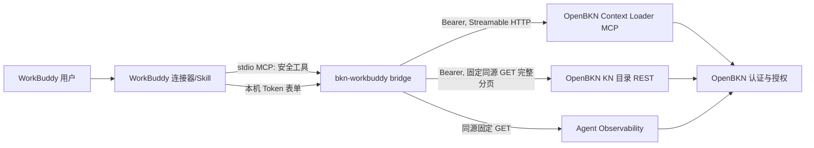

# bkn-workbuddy：OpenBKN 接入 WorkBuddy 技术方案

> 状态：研究与开发交接稿，2026-09-25 初稿；2026-09-28 按评审修订并记录用户已确认的 D1–D6（见 §0）。未开发、未安装、未连接真实 WorkBuddy/OpenBKN 运行链；**开发待用户通知后启动**。除本地仓库代码和本机安装结构外，平台资料以读取当日的腾讯官方页面为准（连接器文档与 CodeBuddy Hook 文档于 2026-09-27 复读）。当前本机 WorkBuddy `CFBundleShortVersionString=5.6.2`。适配目标须在开发时锁定并复测版本。

本方案对照工作区共通基线 `AGENT_INTEGRATION_BASELINE.md`（内部文档 AGENT_INTEGRATION_BASELINE）：其中“一宿主会话一 KN”“自动逐轮收尾”“真实授权拒绝”是目标行为；WorkBuddy 宿主扩展点不足时须按下文降级并作为发布差距记录。

## 0. 2026-09-28 修订与已确认决策

### 0.1 用户已确认的决策

| 编号 | 决策 | 对方案的约束 |
| --- | --- | --- |
| D1 P0 白名单 | 默认**窄白名单**：只含 schema/对象/关系/指标类只读工具，不含 `run_code`、`execute_tool`（及 `run_sql`、`execute_action`、`execute_skill`）。R0a 用窄白名单直连平台跑样例用例；若 `bom-structure`、`purchase-flow` 等无法作答，再单独决策是否在 P0.5 放开 `search_tools + execute_tool`（仅限平台已发布函数）。 | §4 第 5 条、§7 R0a/R1、§8 WB-03/04 |
| D2 共享代码位置 | 从 `bkn-dsh@3f99235` **复制**可移植纯逻辑到 `bkn-workbuddy/packages/core`，每个文件标注来源 commit 与改动；**不修改 bkn-dsh**。OpenClaw 开工时再评估抽取公共包。 | §4.2 模块表、§7 R1 |
| D3 仅得 C 路线时 | 按原方案**停在技术原型、不发布业务发行版**；不以“每次检索级溯源”缩小产品范围。 | §4.1、§7 G1 |
| D4 仓库 | 公开仓库 `openbkn-ai/bkn-workbuddy`（2026-10-22 起）；验收原始记录、交接文档和宿主探针放在内部仓库。推送需用户批准。 | §7 R1 |
| D5 WorkBuddy 桌面操作 | R0b/R3/R4 的安装探针、填写表单、发起提问，由用户手动操作或授权开发 Agent 用 computer-use 驱动，**在 R0b 启动时按用户当次指示执行**；未获授权前由开发 Agent 提供逐步操作清单、用户手动执行。 | §7 R0b/R3/R4 |
| D6 真实授权环境 | 当前无非放行授权服务；WB-06、WB-10 的权限结论先标 `blocked`，不阻塞 R0–R4。本地 permissive stub 只证明功能链路。 | §8 |

### 0.2 本次修订的主要更正（依据见 §10 新增来源）

1. **工具面以目标部署为准**：`bkn-foundry` 文档（0.1.3）列 `search_capabilities`、无 `query_metric`；实际联调的 EE 0.1.4 在 `bkn-dsh` 中使用 `query_metric`、`run_code`、`search_tools`、`execute_tool`、`explore_subgraph`、`search_instance`、`find_skills`。[B8] 白名单只能从目标部署 `/mcp/info` 生成并锁定 `toolkit_version`。
2. **窄白名单可能答不出部分样例**：DSH 实测中模型把指标/实例查询放进 `run_code`，路由规则把 BOM 展开等交给 `search_tools → execute_tool`。[B8][B9] 由 R0a 实测决定（D1）。
3. **生命周期惰性开启**：同一 WorkBuddy 任务中的非业务轮不创建 Interaction；提问事件只记录问题，首个业务工具调用时 start，结束信号到达且已开启才 finish（沿用 bkn-dsh“访问轮恰好一个、非访问轮零个”）。[B8]
4. **工具形态改为白名单透传**：原生只读工具透传平台 schema（剥掉 `kn_id`/`bkn_context` 后由桥接器注入）；桥接器自有工具仅 5 个。放弃自造 `query_objects` 等包装层。
5. **B 路线具体化**：CodeBuddy Hook 规范提供 `UserPromptSubmit{session_id,generation_id,prompt}`、`PreToolUse.modifiedInput`、`Stop{session_id,generation_id,transcript_path}`、插件 `hooks/hooks.json`；WorkBuddy 插件页支持添加第三方插件市场。[W11][W6] Hook 只存在于**插件**形态，连接器规范无 Hook，故交付形态可能是“连接器 + 伴随插件”或“纯插件”，由 G1 决定。
6. **运行时与 TLS**：本机 WorkBuddy 托管 Node 为 v22.22.2，`runtime.version` 语义（精确/范围）文档未定义。[L3][W1] 本地平台为非回环自签证书，须用 CA 信任而非跳过校验。[L4]
7. **补充风险**：业务结果流向 WorkBuddy 云端模型与会话历史；WorkBuddy Agent 具备本机命令能力，“模型不可伪造”只对工具参数通道成立；MCP 工具审批可能逐次弹窗。见 §4 第 7 条与 §9。
8. **自相矛盾修正**：§5 Skill 说明不再出现句柄与 `get_provenance`。

### 0.3 R0a 结果（2026-09-28，详见 （内部记录）（内部记录））

- **D1**（2026-09-28 审核后更正）：窄白名单下 **5 个**样例用例单次实例查询即与基准一致；`bom-structure` 基准未核验；`purchase-flow` 采购订单关联存疑。`phase-c-cases.mjs` 曾把 JSON-RPC 错误当成 0 行，已修复、待重跑后重判。目前只是可达性方向，不是模型表现或验收证明。P0 仍不开放 `run_code` 或已发布函数。
- **修正**：`/mcp/info` 无 `toolkit_version`，改为桥接器自算“白名单工具名 + 输入 schema”指纹；平台工具 `annotations` 全为空；实际部署工具名为 `list_published_toolboxes`/`list_published_tools`/`execute_published_tool`（无 `search_tools`/`execute_tool`），另有 `run_shell`。
- **幂等**：单独的调用 ID 被忽略；宿主会话键 + 调用 ID 重放报 `evidence_capture_failed`，不复用原 Interaction。宿主会话键可把 `new` 映射回同一 conversation；同一 conversation 同时只允许一个进行中的 Interaction，重复 start 返回 `current_interaction_id`。桥接器对 start 不自动重试，用这条路径恢复。
- **路由**：MCP 固定 `/mcp/`（无尾斜杠会先 307）；自检用无尾斜杠的 `/mcp/info`，不采用其返回的 `endpoint`。观测接口必须显式发送 `x-business-domain`，否则 403；MCP 数据面不看业务域头（放行 stub 下）。
- **溯源**：实例/对象类查询由平台自动生成已解析的业务引用和回执；只用 `query_metric` 的轮次业务图为空；自行声明 `business_refs` 被拒，P0 不声明。
- **身份**：access token 为不透明字符串，无法本地解出主体；未找到已文档化的“当前主体”接口，由 R1 决定接口或按降级规则处理。

### 0.4 R0b 第一轮结果（2026-09-28，详见 （内部记录）（内部记录））

- **A 路线部分成立**：`tools/call` 的 `_meta` 带 `workbuddy.ai/conversationId`（任务级，重启后不变）、`workbuddy.ai/requestId`（轮次级）、`workbuddy.ai/messageId`（调用级），模型无法经工具参数改写。宿主**不提供**用户完整问题、本轮结束信号和最终回答。
- **B 路线未验证**（审核后更正，原“基本不可行”过强）：插件入口缺失不等于 Hook 不可用；第三方包记录过 WorkBuddy 5.5.4 运行用户级 `command` Hook（合并 `~/.workbuddy/settings.json`）。由 **R0b-2** 实测，见 （内部记录）（内部记录） §5。
- **分发与凭证**：连接器无法本地侧载，只能“自定义 MCP”粘贴 JSON；其 `env` 明文写入 `~/.workbuddy/mcp.json`，WorkBuddy Agent 可读取，**自定义 MCP 只用于开发、不放真实令牌**；Token 表单、`staticEnv`、Skill、`runtime` 须在首个提审包中验证。
- **进程模型**：MCP 进程归属各任务的 Agent 工作进程并会被不定期回收；`tools/list` 无 `_meta` 且频繁调用 → 绑定按 `conversationId` 持久化，工具目录对所有任务相同，约束在调用时执行。托管 Node 为 v22.22.2。
- ~~G1 候选“A′ 路线”（延迟收尾）~~ **作废**：本地平台源码拒绝无 `answer` 的 `completed`，延迟收尾补不齐最终回答，不能以占位或模型自报代替。
- **下一步 R0b-2**：用户级 `command` Hook（`UserPromptSubmit` 取真实问题，`Stop` + transcript 取真实最终回答）+ MCP `_meta` 的唯一关联。G1 通过条件以审核文档 §5 为准；不满足则按 D3 停在技术原型。

### 0.5 R0b-2 结果（2026-09-28，详见 （内部记录）（内部记录））

- 用户级 `command` Hook 在 5.6.2 可用；`UserPromptSubmit.prompt` 为用户原文；Hook `session_id`/`generation_id` 与 MCP `conversationId`/`requestId` 取值相同。
- `Stop.last_assistant_message` 在正常完成时等于 transcript 中 `status: completed` 的回答；取消同样触发 `Stop`，transcript 记为 `incomplete`，工具执行中取消另有 MCP `notifications/cancelled`。
- 两任务并发不串；重启后任务键不变；编辑重发以 `resend-fork-notice` + `parentId` 形成分支。
- H01–H07 通过，H08 轮次间通过（回答中途退出未测），H09 已观测，H10/H11 未测，H12：界面「默认」即 `bypassPermissions`，不弹审批。
- **G1 待用户确认**：技术条件满足；凭证路径未满足（自定义 MCP `env` 不可承载真实令牌，连接器表单与其他候选未验证）。

### 0.6 G1 决策（2026-09-28，用户确认）

**有条件通过，进入 R1。**

- 路线：用户级 `command` Hook（`UserPromptSubmit` 取原问题、`Stop` + transcript 判定完成/取消并取最终回答）+ 本地 stdio MCP 桥接器；任务/轮次键取 Hook `session_id`/`generation_id`，并与 MCP `_meta` 交叉校验。
- 交付形态：本地安装器（合并用户级 Hook、添加自定义 MCP 配置、可逆卸载）；连接器上架后续再评估。
- 条件：R1 第一个工作包先验证**凭证方案**；通过前只做功能开发，不发布业务版本。
- 按 D4，R1 启动时在 `bkn-workbuddy/` 执行本地 `git init`（不提交、不推送）。——已执行（2026-09-28）。

### 0.7 R1 凭证探针第一轮（2026-09-28，详见 （内部记录）（内部记录））

- 0600 文件、钥匙串默认访问控制：桥接器与 WorkBuddy Agent **都能静默读取**；Agent 的命令沙箱不限制读家目录文件和调用 `security`。
- 钥匙串空信任列表：每次读取弹窗要求登录密码，且对话框无法区分请求方；桥接器进程频繁重建，不可用。
- 待决：接受“同用户威胁模型”（钥匙串默认访问控制 + 短时令牌），或先做 R1-C2 探针（信任列表只含签名的桥接器可执行文件）。——用户选择 R1-C2。

### 0.8 R1-C2 结果（2026-09-29，详见 （内部记录）（内部记录））

- **成立**：由 hardened 签名程序自己写入的钥匙串条目，只有该程序能静默读取；WorkBuddy Agent 经 `security` 读取每次弹窗，拒绝后读不到；10 分钟主动绕过未取得明文。改字节即被系统杀掉，重签即失去授权；注入与调试器附加被 hardened runtime 挡住（未启用时两者都能静默成功）。
- **方案影响**：令牌存取与所有带令牌的请求必须在该签名程序（凭证网关）内完成，网关自身执行白名单与固定来源；Node 层只做业务逻辑，经 IPC 请网关代发。
- **外部依赖**：ad-hoc 签名每次升级都需重新登录；正式发行需组织的 Apple Developer ID 签名。
- **待决**：网关实现语言与进程结构（见对话中的选项），以及 Developer ID 的获取。

### 0.9 凭证网关决策（2026-09-29，用户确认）

- 采用方案 A：独立的签名“凭证网关”负责令牌存取与所有带令牌请求（含白名单、固定来源、`bkn_context` 注入）；Node 桥接器负责 MCP、绑定、生命周期、Hook 与依据呈现，以子进程方式调用网关。
- **须同时支持 macOS 与 Windows**：网关语言由 Swift 改为可跨平台的原生语言（建议 Go；本机已有 Go 1.25.5）。macOS 通过系统钥匙串实现“仅网关可读”；Windows 的凭据存储与进程隔离能力不同，需单独评估与实测（见对话）。
- 签名与升级：暂不定；先评估比 Apple Developer ID 更轻的替代方案。——R1-C3 实测：自签名证书**不能**免去升级后重新登录（重新构建后读取被拒）。现阶段采用“升级后重新登录一次”（网关内置浏览器登录）；网关自管令牌迁移、Apple Developer ID 留待发行前决定。
- Windows：用户有可安装 WorkBuddy 的 Windows 机器，R1 期间准备 Windows 版宿主探针。

### 0.10 R1 进度（2026-09-29）

| 工作包 | 状态 | 验证 |
| --- | --- | --- |
| `packages/core`（TypeScript，零运行时依赖） | 已完成首版：KN 目录解析与完整分页、选择 key、任务绑定、生命周期结果投影、溯源投影（复制自 `bkn-dsh@3f99235`，文件头注明改动）；transcript 解析与轮次答案判定、轮次状态机、`read-v1` 工具合同（schema 投影、指纹、参数校验与注入） | `npm run check:contract`：29 项通过（Node 24 与 WorkBuddy 托管 Node 22）；工具合同测试直接使用 R0a 工具目录快照 |
| `gateway/`（Go，零第三方依赖） | 已完成骨架：`login`（从 stdin 读取，建议用 AppKey）/`status`/`logout`/`serve`（行式 JSON）；macOS 钥匙串（网关自写）、Windows DPAPI；固定来源与路由、拒绝重定向、附加 CA、8 MB 响应上限；MCP 会话与 SSE、会话过期重建一次；白名单与参数检查在网络请求之前执行；宿主会话键加盐哈希 | `go test`：10 项通过；集成测试对本地平台（内存存储，令牌只经进程环境）连续 3 次通过：目录、工具过滤、start → 查询 → finish、`run_sql` 本地拒绝、operations/business-graph 可读；签名二进制用假令牌完成钥匙串写入/读取/删除；Windows amd64/arm64 仅交叉编译通过，**未在 Windows 上运行** |
| 自测中发现并修复 | 不在白名单的工具会先建立 MCP 会话再拒绝 | 先加失败测试复现，修复后通过 |
| 验证包与场景包（2026-09-29） | `schemas/eval-pack.schema.json`、`schemas/scene-pack.schema.json`（三宿主共用，JSON 格式无依赖）及 `packages/core` 中的同规则校验器；`eval/packs/supply-ontology.v1.json`（迁移 10 个用例，`expectTools` 经审阅映射到 `read-v1` 工具，见 `eval/packs/README.md`）；`scenes/governed-business-analysis.v1.json` 与起步问题渲染（只用已披露的名称与可用能力） | core 测试增至 35 项全部通过；独立的 Python `jsonschema` 校验两个包均有效、损坏包被拒；测试核对 schema 枚举与 TS 常量一致 |
| 桥接器→网关通信层（2026-09-29） | `packages/bridge`：`GatewayClient`（懒启动子进程、按 id 匹配、超时即重启、退出/未配置/缺失的明确错误）与面向用户的中文状态映射 | 9 项测试通过（连续 3 次）；测试中发现“超时后旧进程的退出事件误伤新请求”并修复；与真实 Go 网关的协议兼容测试 2 项通过（临时配置、不写凭证、不联网） |
| Windows 宿主探针包 | （内部记录）：多写法 Hook 安装器、网关 DPAPI 自测脚本、打包脚本 | 2026-10-19 已在 Windows 上运行，结果见 §0.11 |
| R2 桥接器（2026-10-19） | MCP 服务（5 个自有工具 + read-v1 透传，契约指纹不符即撤下业务工具）、Hook 接收与 transcript 收尾、跨进程任务状态、安装器（plan/install/login/status/doctor/uninstall）；实现差异见 `docs/STATUS.md` §6 | bridge 28 项单元/进程测试；对 CE 测试平台 实时端到端 14/14（（内部记录）），业务对象引用因平台依据整理未完成而阻塞 |
| 未开始 | 真实 WorkBuddy 宿主验收、R4 验证执行器、发行签名与打包 | — |

- **`agent_name` 定为 `bkn-agent-workbuddy`**（2026-09-29，用户确认）：写死在网关（`gateway/policy.go` 的 `AgentName`），网关拒绝其他取值；本地部署无需事先登记即可使用，正式部署是否限制名称待真实授权环境确认。发布后不再更改。

### 0.11 R0b-W Windows 结果（2026-10-19，详见 （内部记录）（内部记录））

- WorkBuddy 5.8.3（Windows）上，W2 标识关联、W3 回答与取消判定、W4 并发/重启/编辑重发、W5 进程模型都与 macOS 一致；W7 网关经私有 CA 访问 `https://openbkn-ce.example.test` 成功。路线不变。
- **Hook 由 Git Bash 执行**；Hook 以退出码 2 结束会拦截用户提示。安装器统一生成“正斜杠路径 + 双引号”写法；Hook 入口必须失败放行，总是以 0 退出。
- 托管 Node 的路径带构建后缀，可能随升级变化；Hook 不能写死这个路径。
- **未签名的网关 exe 会被 360 直接删除**。Windows 发行版必须做 Authenticode 签名，并纳入发布前的签名决策。
- W6（Agent 能否解密 DPAPI）结论不成立：模型拒绝执行，不是安全边界；Windows 凭证隔离差距按原判写进发布说明。
- 测试平台自 2026-10-19 起改为 `https://openbkn-ce.example.test`（内容与 EE 测试平台 相同，CA 为 OpenBKN Test 015 Local CA），不再访问 EE 测试平台。

### 0.12 两档记录与平台侧溯源（2026-10-20，用户确认）

依据：平台代码核实（openbkn-ai `bkn-foundry`、`bkn-studio`、`bkn-docs` main，2026-10-20）与 `bkn-dsh` 的做法，见 （内部记录） 第 5 节。

- **业务溯源统一在 OpenBKN Studio 查看**，插件不再自己展示依据。`openbkn_evidence` 工具和“本轮依据”提示已删除（取代 §4 第 5、6 项与“业务溯源在 WorkBuddy 哪里看”中的对话内依据设计）。企业版（版本为 enterprise/industry 且 `licensed=true`，与 Studio 的页面守卫同一规则）的业务查询结果附带本轮页面链接 `<origin>/studio/observability/business-provenance?conversation_id=…&interaction_id=…`，模型可附在回答末尾；社区版没有该页面，不给链接。`openbkn_status` 返回最近两轮的记录状态与链接。
- **记录分两档**，平台对两档的要求相同：业务调用必须带有效交互，completed 必须带非空回答。
  1. **Hook 档（默认）**：`UserPromptSubmit` 提供用户原话，`Stop` 提供最终回答与取消信号，桥接器自动开记录、收尾（§4 第 3 项）。
  2. **模型档（降级，可作为正式发行行为）**：某一轮没有 Hook 记录时（Hook 未安装或被禁用、云端任务等），业务查询返回 `TURN_NOT_STARTED`；模型调用 `openbkn_begin_turn(question)` 开记录，回答前调用 `openbkn_end_turn(outcome, answer)` 收尾。问题由模型转述，回答由模型提交，与 `bkn-dsh` 的托管会话做法相同。模型忘记收尾时，同任务下一次查询前以 failed 补关；之后再无查询则在 5 分钟租约到期后被平台标为 `abandoned`，不生成企业版历史业务投影。Hook 档的轮次不接受模型收尾，模型档的轮次也不由 Stop 收尾。
- 这修订了 §4 末“内部验证状态机”中“不以‘模型通常会记得调用 finish’作为发布条件”的限制：模型档按“每轮”记录，不是 §4.1 的 C 路线（每次检索），可以作为业务发行版的降级行为。D3 对 C 路线的结论不变。

## 1. 结论与交付范围

**核心目标：业务场景开发者复用 OpenBKN 的业务模型和验证资产，业务用户安装连接器后即可使用。** 新接入一个使用已支持能力的 KN，应只需要发布平台业务定义、选择授权范围并运行同一验证入口；不应为它再开发 WorkBuddy 专属工具或提示词。产品验收遵循共通基线 V1–V6（内部文档 AGENT_INTEGRATION_BASELINE），本节为 2026-09-25 目标复审新增要求，尚未实现。

业务用户的交付流程为：安装/启用已构建连接器 → 在安全表单完成授权 → 在普通对话里按**业务名称**选择知识网络 → 看到适合当前网络的可问示例并直接提问/追问 → 在回答正文查看业务来源。这里“按名称选择”和“示例/依据”是**待开发的连接器工具结果 + 对话呈现**，不承诺 WorkBuddy 已提供专用 KN 选择器、动态快捷卡片或可嵌入的溯源侧栏。[W1][W6]

| 角色 | 首次使用中要做的事 | 不应承担的事 |
| --- | --- | --- |
| 平台管理员 | 部署可达 OpenBKN、发布/授权 KN；提供平台地址与业务域；可为 WorkBuddy 项目配置共享连接器入口，但应选**个人授权**以保留调用者身份。[W7] | 不替用户填个人 Token；不把公共服务账号当作个人权限验收。 |
| 插件维护者 | 锁定 WorkBuddy/Node/桥接包版本，打包送审并提供摘要、升级回退、连接自检、去敏诊断与验证入口。[W1] | 不让业务用户从本仓库运行 `npx` 或编译。 |
| 业务场景开发者 | 维护 OpenBKN 业务模型、指标、规则与测试预期；可增补声明式场景包。 | 不为每个 KN 写 WorkBuddy 代码、手工封装 API 或写宿主专属系统提示词。 |
| 业务用户 | 从已审核的市场/组织分发入口安装连接器，填写本人凭证；一个可见 KN 时按名称确认，多个时从对话列出的名称/简介选择；阅读示例后直接提问。 | 不编辑 JSON/YAML、输入 `kn_id`、传 Interaction ID、手动 start/finish 或运行 Trace CLI。 |

WorkBuddy 官方用户文档证明插件市场安装/管理和连接器管理入口，开放平台要求连接器目录提交审核；**组织私有分发、管理员预填非敏感字段、安装时离线依赖可用性仍需探针**，不能把这些写成已存在的按钮。[W1][W6][W8] 项目文档说明项目连接器可个人或公共授权，且协作任务禁用个人授权连接器；因此首版先限定**个人授权的普通任务**。如要求共享/协作任务，需验证能否以真实成员身份调用 OpenBKN；不得改用公共票据掩盖身份差异。[W7]

**主方案：WorkBuddy 开放平台的「MCP + Skill」连接器，接一个本地 stdio 受控 MCP 适配器。** WorkBuddy 的官方连接器规范明确支持 `connector-meta.json`、`mcp.json`、`token-schema.json`、`skills/`，本机自填 Token，以及 Node 运行时；OpenBKN Context Loader 已提供 Streamable HTTP MCP。适配器负责网络与身份边界、KN 绑定、工具白名单、Interaction 生命周期和溯源投影，Skill 只负责指导用户和模型，不承担安全强制。[W1][B1]

**发布门槛：宿主会话映射尚未证实。** 已查的 WorkBuddy **连接器**文档没有承诺向 MCP 服务暴露不可伪造的任务/轮次 ID、每轮结束事件或最终答案文本。CodeBuddy CLI 的 Hook 文档与 WorkBuddy 的定时“自动化”都不能直接证明这件事。[W1][W5][W9] 显式 `analysis_handle` / `finish_analysis` 只留内部原型；正式只读发行版必须在 §4.1 的 A 或 B 路线实现用户无感的范围绑定和收尾，满足 V1–V5。若宿主没有所需信号且自动路线无法满足同等结果，记为**产品阻塞**，不发布为开箱即用。[B2]

P0 先验证授权只读分析：选择一个可见业务知识网络，查询对象、关系、指标及规则；工具范围按 D1 的窄白名单，`run_code`/`execute_tool` 是否进入 P0.5 由 R0a 数据决定。业务发行版须展示可读的业务引用和操作摘要，Interaction ID 仅用于可选诊断详情。执行动作、执行 Skill、任意 SQL、通用 MCP 工具执行和对外发送后续按能力分期；只读阶段仍须完整通过开箱体验验收。WorkBuddy 暂无已确认的可嵌入自定义溯源面板接口，可用结构化工具结果和回答末尾的简明摘要实现；具体呈现须实测。[B1][B3]

降低开发成本的模块边界：桥接器维护稳定的协议、身份/范围和工具种类合同；对象名称、关系、指标和入门问题从所选 KN 的已披露能力获得。不要把某个样例的对象 ID 或查询步骤写死成发布功能。TypeScript 的通用绑定/投影逻辑按 D2 从 `bkn-dsh` 复制到 `packages/core` 复用；测试共用锁版业务用例，WorkBuddy 只补连接器装载、表单、对话和重启执行适配器。详见 §4.2 和 §8。

### 业务溯源在 WorkBuddy 哪里看

首版把 共通业务呈现合同（内部文档 AGENT_INTEGRATION_BASELINE）落在**同一普通任务的对话**中，不假设 WorkBuddy 有可注入的 DSH 式侧栏或每条回答旁的按钮。连接器工具返回结构化、大小受限的依据，回答末尾显示“本轮依据”摘要：已选 KN、查询状态、正式披露的来源对象/指标及口径；没有平台依据时直接标明。用户说“查看上一轮依据”或“查看刚才那条回答的详情”，桥接器按可信任务键和受控轮次映射定位平台 Interaction，返回分层文本详情：① 本地可核实的执行时间链与平台操作；② 平台正式披露的业务对象/指标/关系，按文字关系列出，不补画缺失图；③ 回执清单或“本轮没有回执”。平台拒绝、未披露、读取失败和未闭合各有不同说明。技术 ID 只在可选诊断详情出现，用户不输入 ID。

这里的**文本详情是交付设计，不是已证实的 WorkBuddy UI 能力**。R0 除验证可信任务/轮次/结束信号，还要实测工具结果是否对用户可见、回答能否稳定保留依据摘要、追问能否准确打开指定旧轮；若无法把这些内容可靠交到用户面前，WB-09 与 V3/V4 不通过。业务图的可视化交互在现有连接器 API 下未获证实，不能在市场说明中宣称拥有 DSH 同款面板。

## 2. 经核实的机制与证据边界

| 机制 | 已验证事实 | 对方案的含义 |
|---|---|---|
| WorkBuddy 连接器 | 官方开放平台把「MCP + Skill」列为 API 服务推荐方式；一个连接器只配置一个 MCP Server；远程 HTTPS SSE/Streamable HTTP、本地 stdio 均支持。[W1] | 适配器以单个 stdio MCP Server 暴露，内部再访问 OpenBKN。 |
| 凭证 | `auth_mode: "token"` + `token-schema.json` 自填表单，自 WorkBuddy 4.23.0 起可用；值在用户本机保存并在连接时注入；`mcp.json` 使用 `${VAR}`，敏感字段用 `password`。[W1] | Token 不随插件包、Skill、提示词或业务结果分发。具体本地存储/进程暴露仍需安全探针。 |
| 版本字段 | `mcp.json.runtime`、`staticEnv`/`staticHeaders`、`preAuth` 从 5.0.0 起支持；`cwd`、`disabledTools` 从 4.22.15 起；`npmRegistry` 从 4.22.0 起（数组回退 4.24.0）；新字段需声明 `minWorkbuddyVersion`。官方示例写 `"version": "20"`，未定义精确版本还是范围；本机托管 Node 实为 v22.22.2，已有市场连接器使用 `">=18.0.0"` 写法。[W1][L3] | 最低版本写 `5.0.0`；桥接器打成单文件、零运行时依赖、以 Node 20 为下限并在 20/22 双版本测试；`runtime.version` 写法由 R0b 实测决定。私有 npm 源可用 `npmRegistry`；随包本地文件的路径解析文档未定义。 |
| Skill | 连接器可带多个 `skills/{name}/SKILL.md`，会加载为 AI 使用说明；独立 Skill 官方格式为 YAML frontmatter + Markdown，`description`、`description_zh`、`description_en`、`version`、`author` 为必填，`allowed-tools` 可选。[W1][W2] | 编写操作边界、问答流程和错误恢复说明；`allowed-tools` 也不能替代适配器白名单。 |
| 专家/专家团 | WorkBuddy 专家用 `.codebuddy-plugin/plugin.json`、`agents/*.md`；可通过 `dependencies.connectors` 声明已上架连接器，召唤前弹出连接引导；专家开发者不能自行授予工具权限。[W3][W4] | 可作为二期“业务知识分析专家”入口，依赖连接器；不作为 P0 执行/治理层。 |
| 通用插件与 Hook | CodeBuddy CLI 官方文档支持 `.codebuddy-plugin/plugin.json`、`hooks/hooks.json`（插件启用时自动合并）和多个事件；WorkBuddy 用户文档列 Skill/MCP/Hook/Agent/Rule，并可在插件页“+”添加第三方插件市场地址。[W5][W6] Hook 输入：`UserPromptSubmit` 含 `session_id`、`generation_id`、`prompt`；`PreToolUse` 含 `tool_name`、`tool_input`，可返回 `modifiedInput`（部分字段覆盖）与 `permissionDecision`；`PostToolUse` 可返回 `additionalContext`/`updatedToolOutput`；`Stop` 含 `session_id`、`generation_id`、`transcript_path`；MCP 工具按 `mcp__<server>__<tool>` 匹配；插件 Hook 可用 `CODEBUDDY_PLUGIN_ROOT`。[W11] | 字段恰好覆盖 B 路线所需的任务键、轮次键、问题与结束信号，但这些都是 **CodeBuddy CLI** 文档，**未证明 WorkBuddy 桌面端执行插件 Hook**，也未证明 Hook 作用于连接器提供的 MCP 工具。连接器规范本身没有 Hook。R0b 必须实测。 |
| 连接器会话元数据 | 连接器文档未提及 MCP 请求 `_meta`、请求头或任务/轮次/会话 ID。[W1] | A 路线无文档支撑，只能靠 R0b 回显探针实测。 |
| MCP 工具审批 | 本机存在 `~/.workbuddy/mcp-approvals.json`（仅确认文件存在，未读内容）。[L1] | 工具调用可能逐次弹审批，影响“直接提问”；R0b 验证 `annotations.readOnlyHint` 是否可免审批。 |
| 本机实例 | `~/.workbuddy/plugins/marketplaces/experts/plugins/*/.codebuddy-plugin/plugin.json` 有 `expertType: agent` 示例；本机应用版本 5.6.2。[L1] | 只证实本机安装结构，不能由缓存反推官方稳定 API；未读取本机凭证/会话内容。 |
| OpenBKN MCP | 本地 `bkn-foundry` Context Loader OpenAPI 0.1.3 定义 `POST /api/agent-retrieval/v1/mcp`、`GET /mcp/info`、Bearer OAuth/AppKey、Streamable HTTP；`bkn_start_interaction`/`bkn_finish_interaction` 是受管生命周期工具。[B1] 文档工具目录与实际部署不一致：EE 0.1.4 另有 `query_metric`、`run_code`、`search_tools`、`explore_subgraph`、`search_instance`、`find_skills`，文档的 `search_capabilities` 在 bkn-dsh 中未使用。[B8] | 复用标准 MCP 客户端，不重写 JSON-RPC；白名单与 schema 以目标部署 `/mcp/info` 为准，锁定 `toolkit_version`，启动时校验 tool list/schema，未知版本 fail closed。 |

参考版本：本地 `bkn-foundry` commit `5eeaa90f08ddb8539525f88475094e284b5a4153`；`bkn-dsh` commit `3f99235508b20b2587f4a5f9cfa3badecf769ff5`（2026-09-25 读取得到；各仓库是否与部署镜像一致仍待确认）。`bkn-dsh` 已实现一会话一 KN 的事件绑定、令牌仅在运行时注入 MCP、跨轮 conversation 与每轮 interaction 的区分，可复用**设计和测试不变量**，不能把 DSH 的扩展 API 直接搬到 WorkBuddy。[B2]

## 3. 备选架构与取舍

| 路径 | 优点 | 关键限制 | 结论 |
|---|---|---|---|
| WorkBuddy 直接连 OpenBKN 原生远程 MCP + Skill | 文件少，快速验证连接、`tools/list`。 | 原生 MCP 暴露动作、SQL 等全部已启用工具；`disabledTools` 属 WorkBuddy 侧隐藏而非服务端强制；KN、`bkn_context`、生命周期仍交模型维护。 | 只作隔离环境连通性探针，非发布方案。 |
| **WorkBuddy 连接器 → 本地 stdio 适配器 → OpenBKN MCP/固定 REST** | 在代理层强制只读白名单、KN/平台绑定、参数和结果投影；本机 Token 模式符合官方连接器路线。 | 需交付跨平台 Node 包与升级测试；尚缺可信宿主会话/轮次事件。 | **主方案**。 |
| 远程托管 MCP 网关 | 可集中运维和策略更新。 | 自填 Token 将经过另一个服务；企业私有 OpenBKN 需公网/专线可达；额外信任面。 | 企业明确要求、完成数据治理后再评估。 |
| CLI + Skill | 可利用 `openbkn` CLI 登录态。 | 官方要求 CLI 管理 install/auth/status/unAuth；其浏览器 URL、状态轮询和重启持久化有专门约束；模型经 shell 调 CLI 难以形成固定工具边界。[W1] | 不选作 P0；可作后续认证桥，但不得把 Token 打印给模型。 |
| WorkBuddy 插件（第三方插件市场）+ Hook，可与连接器并用 | 插件可含 MCP、Skill 与 `hooks/hooks.json`，是唯一文档化的逐轮/结束事件来源；可经自有插件市场地址分发，开发期可本地迭代。[W6][W11] | WorkBuddy 桌面端是否执行插件 Hook 未证实；插件形态没有连接器的 Token 表单，纯插件需另行解决凭证收集；“连接器 + 伴随插件”需用户安装两件，体验成本更高。 | B 路线的承载形态，候选之一；G1 按 R0b 结果在“纯连接器 / 连接器 + 伴随插件 / 纯插件”中选定。 |
| WorkBuddy 专家内置 MCP | 有启动前连接向导与行业角色入口。[W3] | 专家提示词不能自行增加工具/强制策略；`dependencies.mcpServers` 与连接器产品的版本和状态可能重复。 | 二期只依赖已上架 `openbkn` 连接器，不另建独立连接。 |

## 4. 模块、数据流和强制边界



建议仓库结构：`packages/core/`（D2 复制的纯逻辑）、`packages/bridge/{src,tests}/`、`connector/{connector-meta.json,mcp.json,token-schema.json,icon.svg,skills/openbkn-context/SKILL.md}`、`plugin/{.codebuddy-plugin/plugin.json,hooks/hooks.json,hooks/*}`（仅 G1 选定 B 路线时）、`probes/`（R0 回显 MCP 与 Hook 探针，不进发行包）、`scenes/*.yaml`、`eval/schema/`、`eval/workbuddy-driver/`、（内部记录）。`scenes/` 不打包验证期望答案；`eval/`、`probes/` 不进入业务用户发行包。此处是开发目标清单，**尚未创建这些文件**。

1. **配置与连接**：WorkBuddy 在本机表单收集 `OPENBKN_TOKEN`；组织包应由管理员预置 `OPENBKN_BASE_URL` 与 `OPENBKN_BUSINESS_DOMAIN`（或给安全默认值），用户不应自行猜业务域内部标识。通用包可请用户填写管理员提供的平台地址。适配器把 URL 规范化为 HTTPS；仅明确开发模式且仅回环地址可用 HTTP。禁止跨源重定向、任意 MCP URL、URL 中用户信息、响应返回的后继 URL；所有请求固定到同一个平台 origin。`businessDomain` 仅在部署允许清单内使用；`bkn-dsh` 使用 `bd_public` 并给 REST 读请求发送 `x-business-domain`，新适配器应核验 MCP/REST 各路由的实际业务域处理后统一实施（`bkn-dsh` 的 MCP 客户端只发 `Authorization`，不发 `x-business-domain`）。[B1][B2] **私有 CA/自签证书**：企业部署和本地测试平台（`https://openbkn-ee.example.test`，自签）都需要信任非公共 CA；桥接器通过 `NODE_EXTRA_CA_CERTS`（本地用 （内部记录））或发行者预置的 CA 路径信任证书，**发行包不提供跳过证书校验的开关**；该变量能否经 `staticEnv`/表单注入 stdio 进程由 R0b 验证。[L4]
2. **发现与绑定**：在首次绑定和 `bkn_start_interaction` **之前**，桥接器用当前主体的 Bearer 调固定同源控制面 `GET /api/bkn-backend/v1/knowledge-networks`，按 `offset/limit` 读取 `entries/total_count` 直至完整分页，投影 `{id,name,comment}`（把 `comment` 作为简介）；不能以需要 `bkn_context` 的业务 MCP 自举。`bkn-dsh` 当前仅请求 `limit=100` 的第一页，新桥接器不能照搬这一分页行为。展示只含名称/简介和临时 `selection_key`，不展示内部 ID。名称重名时加简介及其他已授权的可区分信息；桥接器把 `selection_key` 映射到该次目录里的 KN ID，过期/跨主体失效，并在绑定前重新查权限。用户只说业务名称，模型可从目录结果传临时 key。正式路径须把 `{平台 origin,主体,业务域,kn_id}` 与**可信 WorkBuddy 任务键**或等效自动任务范围一次性固化；后续业务参数不可覆盖 `kn_id`/平台/`bkn_context`。只有一个可见 KN 也应显示所用名称，不能静默切换。[B3][B7]
3. **交互生命周期（惰性开启）**：可信宿主事件给出用户本轮完整问题时，适配器**只记录**该问题与轮次键；本轮**首个业务工具调用**到达时才自动 `bkn_start_interaction`，不访问 OpenBKN 的轮次不创建 Interaction（沿用 `bkn-dsh` “访问轮恰好一个、非访问轮零个”的规则[B8]）；收到结束信号且本轮已开启时才 finish。平台判定 conversation 失效（`resource_not_disclosed`、`conversation_owner_mismatch`）时本轮最多一次改用 `new`。start 的第一次 `conversation_mode=new`，后续携带平台返回的 `conversation_id` 用 `continue`；每个业务工具由适配器附上当前 `bkn_context={conversation_id,interaction_id}`，模型无权填写。每轮完成答案后 `bkn_finish_interaction` 只关闭 interaction，不关闭 conversation。超时或用户取消不得伪造成功 finish；记录未闭合状态及可观测计数。若宿主无结束事件，必须验证 §4.1 的原子工具调用路线是否能交付明确较窄的“每次检索”溯源；否则业务发行版阻塞。[B1][B2]
4. **幂等与恢复**：如宿主可提供可信会话键/调用 ID，适配器用 `X-OpenBKN-Host-Conversation-Key`、`X-OpenBKN-Client-Invocation-Id` 或对应 MCP `_meta`，且 ID 由适配器生成/校验，**不作为模型参数**。同一 ID 的安全重试维持相同输入；无逐调用提示时是至少一次语义，禁止对动作自动重试。**R0a 实测（本部署）**：调用 ID 单独使用被忽略；与宿主会话键同用时重放报 `evidence_capture_failed`，不复用原 Interaction。因此桥接器对 start 不自动重试，超时后以同一宿主会话键再 start，从 `interaction_in_progress` 的 `current_interaction_id` 接管；宿主会话键取“宿主任务键 + 本机随机盐”的哈希，是否按主体隔离待真实授权环境补测。只在 OpenBKN 明确返回 conversation 已失效/主体不匹配时清除旧 ID；401、5xx、超时不能清除绑定或偷偷新建 conversation。[B1][B2]
5. **工具边界（白名单透传 + 5 个自有工具）**：桥接器自有工具只有 5 个：连接状态自检、列出可访问网络、按临时 key 选择网络、当前网络入门问题、查看本轮/上一轮/指定轮依据（名称实现时定，如 `openbkn_status`、`openbkn_list_networks`、`openbkn_select_network`、`openbkn_starters`、`openbkn_evidence`）。业务查询**不自造包装工具**，而是对 D1 窄白名单内的原生只读工具（以目标部署 `/mcp/info` 为准，EE 0.1.4 候选：`get_kn_detail`、`search_schema`、`get_object_types`、`get_relation_types`、`query_object_instance`、`query_instance_subgraph`、`query_metric`、`get_logic_properties_values` 等[B8]）**透传平台 schema 与描述**，只从对外 schema 中剥掉 `kn_id`、`bkn_context`，调用时由桥接器注入。这样平台工具描述随部署更新，接第二个 KN 不改代码（V1）。任务绑定和当前 interaction 由受控宿主事件/桥接器内部状态决定，**正式工具参数不暴露 `analysis_handle` 或 `finish_analysis`**。透传时校验入参 schema、工具响应体/数组上限/超时；任何未知工具、跨 KN 的 `kn_id`、任意 URL、任意 SQL/代码（含 `run_sql`、`run_code`）、`execute_action`、`search_tools`/`execute_tool`、`execute_skill` 在 P0 均拒绝（D1；`search_tools`/`execute_tool` 是否在 P0.5 放开由 R0a 数据另行决策）。`execute_skill` 在 OpenBKN 默认关闭，但适配器仍须显式拒绝。[B1] 只给 WorkBuddy 侧设置 `disabledTools` 不能作为安全保证。
6. **溯源**：每轮以平台返回的 Interaction ID 为准，通过同源固定 REST 路由读 `/api/agent-observability/v1/interactions/{id}/operations` 和 `/business-graph`，只投影必要的操作 ID、业务引用、状态和时间，限定大小、去除敏感参数。桥接器的依据工具（下称 `get_evidence`）返回业务名称、来源对象/指标、采用的口径、结果状态与必要的引用；模型在回答正文写“本轮依据”，技术 ID 放在可选诊断文本。**正文是否完整引用了所有证据仍需真实 WorkBuddy 的人工/语义验收**；当前无已证实的答案旁原生渲染槽位。无权限/不可见时明确标“依据暂不可查看”，不补造来源。[B3]
7. **日志与存储**：日志只记匿名调用 ID、状态码类别、耗时、工具名和已截断错误码；不记录 Token、请求/响应正文、完整业务数据、模型提示词。会话状态是否落盘取决于 §9 宿主探针；如要持久化，不能把 Token 落盘，绑定须与凭证主体重新校验，并有升级迁移和撤销路径。
8. **数据流出与本机威胁模型**：
   - 工具结果会进入 WorkBuddy 的云端模型上下文，回答可能进入会话历史、记忆或云同步（本机数据目录含 `memory`、`skill-cloud-sync`、`edge-sync` 等，属推断）。[L1] 发行说明须给管理员一份数据流说明；桥接器只投影必要字段并限制结果大小。会话同步行为由 R0b 确认。
   - WorkBuddy Agent 具备本机命令执行能力（数据目录含 `shell-snapshots`，属推断，R0b 确认）。“模型不可伪造”只对**工具参数通道**成立；模型若读取本地文件或进程环境，理论上可接触 Hook 共享密钥或 Token。所有任务共用同一用户 Token，最坏结果是同一用户权限内的溯源错归属而非越权，但 Token 在 stdio 进程环境中的可见性须在 R0b 实测并写入安全说明。
   - 日志中出现的会话/轮次键只记哈希；Hook 读取 `transcript_path` 取最终答案时只在本机处理、只交出受限摘要，不落盘正文。

**内部验证状态机**：若宿主不给可信任务/轮次信号，桥接器可暂以 `analysis_handle` 测 `begin_analysis(handle,full_question)` → 查询 → `finish_analysis(handle,answer_summary)`。句柄仅进程内有效，重启失效；它只能限制同一句柄的 KN，不能阻止同一 WorkBuddy 任务另建句柄，模型传入的 `answer_summary` 也不是可信最终答案。这些工具必须从正式发行包的用户可见工具目录移除；测试人员可在专用探针包中使用。**不以“模型通常会记得调用 finish”作为发布条件。**

状态归属建议：**内部探针包**可在桥接进程内保存 `analysis_handle → {origin, businessDomain, kn_id, conversation_id, current_interaction_id, lifecycle_status}`，其中 IDs 只接受平台成功响应；桥接重启即失效。**正式包**只有取得可信宿主任务键后，才在本机受保护插件数据目录持久化 `{schema_version, host_task_key, origin, businessDomain, kn_id, conversation_id, bound_at}`，并在每次恢复时校验当前凭证主体及 KN 授权。若 OpenBKN 未提供可验证的主体标识，则凭证轮换或主体无法确认时拒绝恢复旧绑定，要求新任务；不保存 Token、Token 哈希、问题/回答正文或开放中的 Interaction。卸载时清理插件的非敏感绑定状态并撤销/删除 WorkBuddy 保存的连接凭证是否由客户端完成，须经 §9 实测后写入卸载说明。

### 4.1 自动任务路线与放行判定

| 路线 | 要验证的 WorkBuddy 能力 | 成立后由谁完成协议步骤 | 失败后的处置 |
| --- | --- | --- | --- |
| A：连接器获得可信任务/轮次元数据 | 在真实 WorkBuddy MCP 调用中，两轮、两个任务、取消/重启各自携带稳定、不可由模型参数冒充的任务键和本轮问题；有可靠结束/失败信号或最终答案通知。官方连接器文档目前未承诺。[W1] | 桥接器按任务键锁 KN，按轮 start → 工具 → finish，持久化 conversation 与溯源。 | 转 B；不得用模型给的 ID 冒充宿主 ID。 |
| B：受支持的 WorkBuddy Hook（插件形态） | 在目标 WorkBuddy 版本验证插件 Hook 在桌面端触发，且**对连接器（或同插件）提供的 MCP 工具生效**；有相同可信任务键；Hook 禁用/崩溃时显式失败，不允许绕行原生 MCP。候选机制（依 CodeBuddy Hook 字段[W11]，待实测）：① `UserPromptSubmit` 把 `session_id`、`generation_id`、`prompt` 经权限 0600 的本地 socket（Windows 用带 ACL 的命名管道）交给桥接器；② `PreToolUse`（匹配 `mcp__<openbkn>__.*`）用 `modifiedInput` 覆盖写入宿主任务键与轮次键，模型传入的同名字段一律被覆盖；③ `Stop` 通知本轮结束，必要时从 `transcript_path` 取最终答案摘要；④ 若 `Stop` 能向用户显示消息，可由桥接器确定性输出“本轮依据”摘要，不依赖模型转述。 | 同 A；Hook 只是可靠事件来源，状态机仍在桥接器。 | 转 C；若 A/B 均不成立，不能保证会话级目标。 |
| C：原子业务读取候选 | 每次高层只读工具在桥接器内自行 start → 一次或一组确定性只读查询 → finish，返回已完成证据；用户不见句柄。模型仍可组合多个工具回答未预写问题。 | 桥接器仅能保证**每次工具调用**闭合，不能证明 WorkBuddy 任务级 KN 不变、完整用户问题或最终回答溯源。 | 仅作范围更窄的探索；**单靠 C 不通过当前共通基线的业务发行验收**。按 D3，若只得到 C，停在技术原型、不发布业务发行版，不缩小产品范围。 |

WorkBuddy 官方“自动化”目前是**定时**发起新任务，不是用户聊天的逐轮回调；开放平台云端任务/ACP API 是第三方应用获授权后创建云任务，并未证明本机 stdio 连接器会被云任务加载，故都不能直接替代 A/B。[W9][W10] 此处“自动任务路线”指**待探针验证的连接器/宿主执行路径**，不是让业务用户设置定时自动化。探针报告须列出事件、载荷字段、丢失/重复/取消行为与版本；一个关键事件缺失即不能宣称会话级强制。

### 4.2 声明式场景与通用适配层

桥接器的输入来自两处：**运行时**的授权 KN 目录、`get_kn_detail(summary)`、`get_object_types` / `get_relation_types` 和 `tools/list`；**可选的版本化产品场景包**只提供领域说明、需要的已支持能力类别和有限示例提问模板。场景包不含 Token、SQL、KN 内部 ID、任意脚本/HTTP 端点、逐题查询程序、期望答案或判题规则。**验证包**单独保存问题、期望事实和断言，只对测试 runner 可见。若不用场景包，通用分析场景仍可从 KN 自描述运行。增加第二个同合同 KN 只需平台业务定义/授权与对应测试预期，不改桥接器源码或连接器 Skill。[B1]

```yaml
# 提议的场景包格式；尚未实现，字段须在 R1 固化为 JSON Schema
schema_version: 1
scene_id: governed-business-analysis
contract_version: read-v1
required_capabilities: [schema_search, object_query]
starter_templates:
  - "列出我能访问的{network_name}中的{object_type_name}，并说明数据来源"
  - "{object_type_name}相关的{metric_name}采用什么口径？" # 仅检测到该指标且支持 query_metric 时才展示
```

| 模块（待实现） | 输入 → 输出 | 强制职责与跨 KN 复用点 |
| --- | --- | --- |
| `workbuddy-package` | 锁定连接器版本/桥接包摘要 → 可安装目录与兼容矩阵 | WorkBuddy manifest、Token 表单、Skill、市场/组织分发、自检；不包含业务 KN 私有数据。 |
| `catalog-and-selection` | 首次绑定/start 前，以 Bearer 调固定同源 `GET /api/bkn-backend/v1/knowledge-networks`，完整分页取得授权目录 `id/name/comment` → 用户可读选项 + 临时选择 key | 按 `offset/limit` 与 `total_count` 遍历、重名消歧、选后复核权限；不能用需 `bkn_context` 的 MCP 业务工具自举；仅对话呈现，不声称原生下拉框。[B7] |
| `capability-profile` + `scene-loader` | KN summary + 工具目录 + 声明式场景 → 版本化允许能力、对象/关系/指标名称、示例问题 | 只接受已知能力合同；未知工具拒绝；模板变量只来自已授权元数据并做长度/转义限制；没有合适的指标就不显示指标示例。 |
| `scope-and-lifecycle` | 可信宿主任务/轮次信号 + 选择 key → 不可变绑定、平台 conversation/interaction ID | 一任务一 KN、逐轮受管 start/finish、幂等、重启恢复；无可信信号时不进入业务发行。 |
| `safe-tool-router` | 已绑定范围 + 白名单原生工具调用 → 固定 OpenBKN MCP 调用 | 透传平台 schema（剥 `kn_id`/`bkn_context`），调用时注入；schema 校验、D1 窄白名单、超时/输出上限；由桥接器生成 `X-OpenBKN-Client-Invocation-Id`；对象/指标名字不写死。 |
| `evidence-presenter` | 完成的 interaction + 两个观测 REST 结果 → `{business_names,source_refs,definition/status,diagnostic_ids}` | 真实业务引用投影；WorkBuddy 回答正文可读，缺失依据不伪造。 |
| `workbuddy-eval-adapter` | 共通 `network/cases[]` + WorkBuddy 驱动 → 共通逐例报告 | 真宿主发问/追问、自动收集可见回答和平台 Trace；难以自动断言的语义留人工。 |

`bkn-dsh` 中的 `session-binding.ts`、`interaction-lifecycle.ts`、`network-capability-profile.ts`、`provenance-handle.ts` 及 `platform-reader.ts` 的固定路由/投影算法是**候选可复用资产**；按 D2 复制到 `packages/core`（标注来源 `bkn-dsh@3f99235` 与改动），再接 WorkBuddy 宿主 I/O，不修改 `bkn-dsh`。2026-09-27 导入关系核查：`auth`、`business-graph-model`、`business-network-catalog`、`interaction-lifecycle`、`interaction-references`、`managed-session-policy`、`native-mcp-provenance`、`network-capability-profile`、`provenance-handle`、`provenance-view`、`session-binding`、`suggested-prompts`、`timeline-fold`、`turn-provenance`、`types` 共 15 个模块无 DSH 依赖。复制时须处理：`platform-reader.ts` 仅类型引用 `JsonValue`（替换即可），但目录只取首页 `limit=100`（`:50`），须补完整分页；`interaction-lifecycle.ts` 去掉 DSH 会话类型增强（`:20-25`）并把写死的 `mcp__openbkn__` 工具名（`:14-15`）参数化，面向模型的 `denialFor` 提示在桥接器自驱生命周期下不再需要；`turn-timeline.ts` 从 DSH 耦合的 `scoped-business-context.ts` 取常量，需改为本地常量；`session-binding.ts` 的事件日志模型改为“宿主任务键 → 不可变绑定”的文件存储，保留规范化与冲突判定。[B2][B5][B8]`business-context-service.ts` 依赖 Cordis、DSH 会话/凭证/客户端 UI 等 API，整包 `package.json` 也要求 DSH peer dependencies 且 Node `^22.19.0 || >=24.0.0`；本方案示例的 WorkBuddy 托管 Node 20 **不能直接运行该整包**。共享模块须独立构建并验证 Node 20 兼容，不能让用户保留 `bkn-dsh` 兄弟源码目录。[B2][B5]

## 5. 建议配置样例（供开发，不含真实凭证）

这些配置是发布者生成和验证的产物，业务用户不手工编辑；安全表单只收集实际部署必须由用户提供的信息。完整发行包需提供自动依赖安装、自检与重新连接入口。

WorkBuddy **连接器规范**采用以下文件（不是 CodeBuddy CLI 的 `.codebuddy-plugin/plugin.json`）：[W1]

`connector-meta.json` 示意：

```json
{
  "source": "openbkn-business-context",
  "type": "mcp",
  "name": "OpenBKN Business Context",
  "name_zh": "OpenBKN 业务知识",
  "name_en": "OpenBKN Business Context",
  "description": "Query authorized business knowledge networks with traceable evidence.",
  "description_zh": "查询授权业务知识网络并查看业务溯源。",
  "description_en": "Query authorized business knowledge networks with traceable evidence.",
  "version": "0.1.0",
  "auth_mode": "token",
  "minWorkbuddyVersion": "5.0.0",
  "examples_zh": ["查询我能访问的业务知识网络", "在选定的知识网络中分析订单延迟的原因"],
  "examples_en": ["List my accessible business knowledge networks", "Analyze order delays in my selected network"]
}
```

`mcp.json` 示意（包名/版本仍为占位）：

```json
{
  "mcpServers": {
    "openbkn-business-context": {
      "type": "stdio",
      "command": "npx",
      "args": ["-y", "@openbkn/workbuddy-mcp-bridge@<pinned-version>"],
      "runtime": { "type": "node", "version": "20" },
      "env": {
        "OPENBKN_BASE_URL": "${OPENBKN_BASE_URL}",
        "OPENBKN_TOKEN": "${OPENBKN_TOKEN}",
        "OPENBKN_BUSINESS_DOMAIN": "${OPENBKN_BUSINESS_DOMAIN}"
      },
      "timeout": 30000
    }
  }
}
```

`runtime.version` 暂写官方示例值 `"20"`，最终写法（精确或范围）由 R0b 定；私有 npm 源用 `npmRegistry`；私有 CA 由发行者预置 `NODE_EXTRA_CA_CERTS`（经 `staticEnv`，待 R0b 验证），不在示例中写路径。`npx` 包名和版本是**未发布占位符**；如采用随连接器打包的可执行文件，需先确认 WorkBuddy 对连接器包路径展开/执行权限的正式行为。生产安装必须固定版本与摘要，避免 `latest` 漂移；`runtime.type=node` 最低 WorkBuddy 5.0.0。[W1] `token-schema.json` 至少定义 `OPENBKN_BASE_URL` 为 `text`、`OPENBKN_TOKEN` 为 `password` 且两者必填；`OPENBKN_BUSINESS_DOMAIN` 也应设必填并给部署允许的默认值（本地样例可用 `bd_public`，企业部署须核验），避免空变量展开歧义。表单键与上面的占位符严格同名。开发阶段不得通过命令参数或 URL 传 Token。[W1]

`token-schema.json` 示意（`bd_public` 只适用于允许该业务域的部署；组织发行者须预置/校验实际业务域，业务用户不猜填）：

```json
{
  "title": "连接 OpenBKN",
  "title_en": "Connect to OpenBKN",
  "description": "配置您有权访问的 OpenBKN 平台。凭证由 WorkBuddy 保存在本机。",
  "description_en": "Connect to your authorized OpenBKN deployment. WorkBuddy stores credentials locally.",
  "fields": [
    { "key": "OPENBKN_BASE_URL", "label": "平台地址", "type": "text", "required": true, "placeholder": "https://openbkn.example.com" },
    { "key": "OPENBKN_TOKEN", "label": "访问令牌", "type": "password", "required": true },
    { "key": "OPENBKN_BUSINESS_DOMAIN", "label": "业务域", "type": "text", "required": true, "defaultValue": "bd_public" }
  ]
}
```

Skill 的 `description` 应明确何时触发，正文只规定“先按业务名称选 KN、只做只读查询、回答末尾呈现依据工具返回的平台证据（本轮依据）、不要执行写操作”，并说明连接失败或需换 KN 时如何重新开始（换 KN 须新开任务）；正式 Skill 不出现句柄、start/finish 或内部 ID；不放 Token、开放式 HTTP 请求命令或能绕开适配器的 CLI 调用。[W1][W2]

二期专家若上架，其 `plugin.json` 可声明 `"dependencies":{"connectors":["openbkn-business-context"]}`，引导用户连接后再进入对话；Agent Prompt 只描述场景和如何使用连接器，不复制凭证或实现规则。[W3]

### 5.1 安装、授权、选择与恢复的实际入口

1. **发行/依赖**：维护者生成固定版本的连接器目录与桥接器包（或经探针确认可用的包内二进制），记录 SHA-256、Node 与 WorkBuddy 最低版本，提交 WorkBuddy 开放平台审核；审核通过后的市场安装是官方路径。[W1][W6] `npx -y @...@<pinned-version>` 只是设计示意，必须验证首次连接是否需要公网 npm、超时和失败提示；若组织要求离线安装，先验证包内可执行路径，否则该环境阻塞，不把“已安装连接器卡片”当作依赖已就绪。官方只写了“提审 → 进入市场（审核通过后约 10–15 分钟同步）”，未写本地侧载；开发期先用用户级自定义 MCP 配置或本地插件市场迭代桥接器，连接器包只在 R3/R5 使用，本地侧载能否用于连接器列入 R0b。后续可评估 `preAuth: "cli"` 接 `openbkn` CLI 登录以替代粘贴 Token（参考 `bkn-dsh` 的 `openbkn-cli-subprocess.ts`），P0 仍用 Token 表单。[W1]
2. **管理员预配**：管理员给出可达平台、业务域与个人授权要求。WorkBuddy 项目官方支持把连接器列为项目资产，但公共授权使用同一票据，不能满足按个人 OpenBKN 主体鉴权；项目个人授权在协作任务中禁用。[W7] 地址/域可尝试用 5.0.0 起的 `staticEnv`，或发行时把安全值写进表单默认值；两者的实际合并/覆盖行为与组织分发须探针。若目标企业部署仍迫使普通用户猜填原始业务域 ID，V3 未通过；通用包允许用户粘贴管理员给的平台地址，但不能要求编辑文件或环境变量。
3. **首次连接/自检**：业务用户在 WorkBuddy 已安装连接器处发起连接，官方 token 表单收集 Token（及未预配的地址/域），桥接器执行固定 origin 校验、`/mcp/info`/`initialize`/`tools/list` 与可访问 KN 目录检查，结果只显示“可用/需重新连接/无可访问范围/平台不可达/版本不兼容”及下一步；不用打印凭证。[W1] 这里的自检工具和中文状态文案是待实现的桥接能力，并非 WorkBuddy 内置 OpenBKN 面板。
4. **按名称进入业务范围**：普通任务里用户说“用供应链知识网络分析…”。桥接器先以已授权固定 REST 控制面完整分页读取 KN 目录；连接器返回业务名和简介，用户确认名称后才绑定任务范围并开始首轮 interaction。不得先调用需 `bkn_context` 的业务 MCP 工具来寻找 KN。单一可见网络可以给出默认建议，但回答仍说明所用名称。出现重名时要求从附加简介中确认，不让用户输入 `kn_id`。随后返回由 KN schema 生成的 2–3 个可执行入门问法（仅在对应对象/指标存在时生成），用户仍可问未预写的同类问题。[B7]
5. **结果/恢复**：回答正文按“结论—业务依据（名称、口径、来源、状态）—不足/下一步”组织；真实 Evidence 由桥接器投影，模型是否忠实呈现仍要验收。401/Token 过期时提示回到连接器管理重新填写凭证；平台暂不可达提示稍后重试且不清除 KN；403/不可见提示联系平台管理员确认业务域/授权；版本不兼容提示升级 WorkBuddy 或联系插件维护者。WorkBuddy 文档支持管理/断开连接器，**未核实可从回复直接跳转管理页**，故不写不存在的按钮。[W1][W6][W8]

## 6. 与 OpenBKN 协议对齐的细节

- `bkn-foundry/docs/api/context-loader/mcp.yaml` 写无尾斜杠 `/api/agent-retrieval/v1/mcp`；当前 `bkn-dsh` 默认拼出带尾斜杠 `/api/agent-retrieval/v1/mcp/`。**不要假设网关会等价处理**；以部署端 `/api/agent-retrieval/v1/mcp/info` 给出的 `endpoint` 与一次真实 `initialize` 为准，记录两条 URL 的响应/重定向行为，再选稳定路由。禁止让 Bearer 随 301/302/307/308 跳到其他 origin。[B1][B2]
- **工具目录以部署为准**：`bkn-foundry` 文档（0.1.3）与实际 EE 0.1.4 的工具名不一致（见 §2）。方案、白名单与测试中的工具名一律以 R0a 从目标部署取得的 `/mcp/info` 为准，文档工具名仅作参考。[B1][B8]
- `GET /mcp/info` 可读取工具目录、schema 和建议客户端配置；**R0a 实测本部署不返回 `toolkit_version`**，版本比对改为桥接器对白名单工具名与输入 schema 计算指纹。启动探针应比对至少 `bkn_start_interaction`、`bkn_finish_interaction` 及 P0 业务工具的名称/输入 schema；未知版本 fail closed。Context Loader 外部 REST 业务调用均 POST；用于首次发现的 BKN 控制面目录和观测读接口则按各自契约 GET。[B1][B7]
- 授权主体由 Bearer 决定，不从调用体中的账号字段决定；首次发现的控制面 KN 目录和后续检索结果仍须由 OpenBKN 服务端按当前身份授权。适配器本地 KN 绑定是额外边界，不能代替平台授权。[B4][B7]
- 本地 `CLAUDE.md` 明确当前 kind 集群的 `authorization-private` 是 permissive stub。它只可验证功能链路，**不能作为真实账号权限隔离、403、跨主体访问验收证据**。权限测试需正式授权服务的独立环境。[L2]
- `bkn-dsh/README.zh.md` 曾说明社区版溯源与 `x-business-domain` 行为；新开发应以目标部署当前 API/License 实测为准。任何 403 不能自动解释为“需升级”；先保留平台错误码，并区分凭证、业务域和访问权限。[B3]

## 7. 开发任务、依赖与交付门

| 顺序 | 依赖 | 开发 agent 的具体交付物（均待实现） | 对应验收 |
| --- | --- | --- | --- |
| R0a OpenBKN 探针（约 0.5 天，只用本地平台） | 本地测试平台可达 | 带/不带尾斜杠的 `/mcp/info`、`initialize`、`tools/list`；记录 `toolkit_version`、start/finish 入参与 `bkn_context` schema；KN 列表 `offset/limit/total_count` 分页；`x-business-domain` 在 MCP/REST 各自效果；观测两路由 200/403/404；是否有“当前主体”接口；**D1 窄白名单直连跑 7 个正向/无数据用例**。去敏证据写 （内部记录）。 | 白名单候选、MCP 路由选择、D1 是否需 P0.5 决策的数据。 |
| R0b WorkBuddy 宿主探针（约 1–1.5 天，桌面端操作按 D5） | WorkBuddy 5.6.2 | ① 回显型 stdio MCP：`clientInfo`/capabilities、`tools/call` 的 `_meta` 与参数、注入的环境变量**名**、每任务一个进程还是共享、`roots/list`、取消通知、重启行为；② Hook 探针插件（本地插件市场安装）：`UserPromptSubmit`/`PreToolUse`/`PostToolUse`/`Stop`/`SessionEnd` 是否在桌面端触发、是否作用于连接器提供的工具、`modifiedInput` 能否注入、`Stop` 能否向用户显示消息；③ Token 表单注入、`staticEnv` 合并、`NODE_EXTRA_CA_CERTS` 透传、日志是否泄露（只记有无）；④ `runtime.version` 语义、`readOnlyHint` 免审批、连接器本地侧载、会话云同步、Token 在进程环境中的可见性。证据写 （内部记录）。 | WB-00；A/B/C 路线判定表。 |
| **G1 决策门** | R0a + R0b | 由用户确认路线（A/B/C）与打包形态（纯连接器 / 连接器 + 伴随插件 / 纯插件）。按 D3，只得到 C 时停在技术原型，**停止业务发行计划**。 | 用户确认记录写回本节。 |
| R1 共享核心与合同（约 1.5–2 天，可与 R0b 并行） | R0a | 按 D4 本地 `git init`；按 D2 复制 `bkn-dsh@3f99235` 纯逻辑到 `packages/core`（平台读取补分页/CA/固定同源/`redirect:'error'`、目录与临时 `selection_key`、任务键→不可变绑定存储、桥接器自驱的惰性生命周期状态机、operations/business-graph 投影）；`read-v1` 白名单（取自 R0a）、产品场景包 JSON Schema、共通测试包扩展 schema；迁移 `supply-ontology.yaml` 并对 `expectTools` 做人工审阅映射；Node 20/22 双版本测试，夹具用 R0a 去敏响应。 | `npm run check:contract` 通过；WB-02、WB-08 的合同部分。 |
| R2 受控桥接器（约 3–4 天） | R1 | 锁版官方 MCP SDK 的 stdio server + 到 OpenBKN 的 Streamable HTTP 客户端；5 个自有工具 + 白名单透传；schema 校验、超时、结果上限；拒绝未知工具/跨 KN/跨源；桥接器生成 `Client-Invocation-Id`；中文状态文案（需重新连接/平台不可达/无权限/版本不兼容，对应 DSH G6 中失败的三类负向用例[B6]）；日志去敏；单文件打包 + SHA-256；显式 handle 探针变体单独构建、不进发行包。 | 脚本化 MCP 客户端在本地平台跑通“选网→查询→依据”；WB-08 安全用例全过；Token 不落盘。 |
| R3 WorkBuddy 包和自动任务路线（约 2–3 天） | G1 选定 A 或 B；R2 可调用 | 连接器目录（`connector-meta.json`、`mcp.json`、`token-schema.json`、Skill、图标、桥接器固定版本与摘要）；如选 B，加插件 `hooks.json` 与 Hook 脚本（经 0600 本地 socket 或 `modifiedInput` 把任务键/轮次键/问题交给桥接器）；自动绑定、逐轮惰性 start/finish、重启恢复；`npm run build:release`。 | WB-01、WB-03～WB-06、WB-10；真实客户端不见 handle/finish，两轮共用同一 conversation。 |
| R4 验证执行器（约 3–4 天） | R1 schema + R3 真宿主可用 | 先做半自动：人按 D5 发问题，执行器自动采集桥接审计与平台 Trace 并断言；UI 自动化作为增强。机器断言与人工 rubric 分列，逐例报告与失败退出码（`npm run e2e:workbuddy`）。执行 WB-00～05、07～11、13；WB-06 按 D6 只记功能链路，权限结论标 `blocked`。 | WB-03～WB-12 与 V2；旧 `run-eval.mjs` 只供用例迁移参考。 |
| R5 业务发行与运维（约 1–2 天 + 审核等待） | R3/R4 通过；真实授权结论按 D6 另行补齐 | 经审核/组织可分发的已构建包、依赖自检、安装/升级/回退/解绑说明、支持版本矩阵、管理员预配指引、数据流说明、业务用户按名选 KN 与错误恢复文案、成本报告；**提交开放平台审核属对外动作，须用户批准**。 | V1–V5、WB-13；记录 V6 与实际人工介入。只有静态/模拟/原型通过时不得宣称发行完成。 |

`R0a/R0b → G1 → R2 → R3/R4 → R5` 是发布关键路径（R1 可与 R0b 并行），估算约 12–17 个工作日，不含市场审核等待与真实授权环境；估算未经实测。R4 的用例 schema 和断言器可与 R2 并行开发，但其“真 WorkBuddy E2E”部分须待 R3。**开发启动须等用户通知。**可选“业务分析专家”在连接器已上架、真实依赖引导通过后单独增加，不阻塞只读产品。动作执行另开能力合同，要求 WorkBuddy 确认入口与真实平台授权；当前读版不显示写工具。

为降低开发者重复操作，R5 文档需固定三个一键入口（建议命名，**当前不存在**）：`npm run build:release` 生成锁版包和摘要；`npm run check:contract` 做离线 schema/状态机/凭证扫描；`npm run e2e:workbuddy -- --cases <测试包> --out <去敏目录>` 显式触发真客户端/平台验证并返回失败退出码。命令实际名称可在实现时调整，但构建、离线检查、真实 E2E 三种能力不得合成一个不区分证据等级的“测试通过”。

## 8. WorkBuddy 真宿主验证与成本证据

**共通输入**：以 `bkn-dsh/docs/eval/supply-ontology.yaml` 的 `network`、`cases[].id/question/expectFacts/expectTools/forbidden` 为起点，先锁定样例数据 commit/导入版本并重新验证事实。**待实现的共通测试合同提案**增加顶层 `schema_version`、`dataset_version`，及逐例 `followups`、`assertions`；三个宿主共用同一验证包。`expectFacts`、`forbidden`、判题代码只在测试端，不进入场景包/Skill/被测模型上下文。原 `expectTools` 有“库存/指标类查询”等描述项，迁移时给每例另建**经审阅映射**到桥接安全工具名和 OpenBKN operation 类型；不能做字符串包含断言。[B6]

**执行与取证**：R4 runner 在一台干净 WorkBuddy 客户端上按 case ID 创建普通任务、通过官方 UI/经验证驱动输入问题和追问，采集可见回答、桥接器去敏调用事件与 OpenBKN Interaction/operations/business-graph；依 `host_task_key → interaction_id → operation_id` 对齐。若目标版本没有受支持的自动驱动 API，可用经批准的本地 UI 自动化；失败时该例标 `blocked` 或人工执行，不能把脚本预写答案回填为宿主结果。开放平台的云任务 ACP API 并未证明能加载本机 stdio 连接器，**不得拿云任务代替此 E2E**。[W10] 旧 `run-eval.mjs` 只逐条询问人工布尔或读人工填的布尔文件，没有发送 WorkBuddy 问题，也没有自动采 Trace；不能称为自动 E2E。[B6]

**自动断言与人工边界**：自动比对协议工具序列、选定 KN、平台签发 ID、无数据/401/403 行为、结构化数值与平台当前查询、回答中可检索的业务引用；语义总结和用户是否理解口径/恢复提示由盲审人员按固定 rubric 判定。机器和人工结论分列，不把“回答像是正确”推成来源正确。每例报告含基线规定的 `case_id`、宿主/插件/平台/模型/数据版本、实际工具序列、业务断言、溯源 ID、权限环境、`passed|failed|blocked|not_run`、证据位置；另记自动与人工耗时、模型调用/费用（实际可得时）和步骤数。失败退出码只基于本次运行确实执行的必需断言，缺证据不能 PASS。

| 编号/对应目标 | 真 WorkBuddy 输入与预期 | 自动证据 / 人工证据 |
| --- | --- | --- |
| WB-00 版本/宿主探针 | 两任务两轮、取消、重启与 Hook 禁用/崩溃，判定 A/B/C 信号和故障可见性。 | MCP 元数据字段名与状态转移记录；不收凭证正文。 |
| WB-01 / V3 干净安装 | 新用户仅有支持版 WorkBuddy 和账号，从审核/组织分发包安装并连接；本人 Token 表单成功，自检列出授权 KN。 | 版本、包摘要、安装与连接结果；人工记录步骤、首次有效答案耗时，构建/手改配置/内部 ID 输入次数必须为 0。 |
| WB-02 场景与第二 KN / V1 | 同一包先选样例 KN，再选含不同对象/指标名的第二 KN；两者均能显示正确名称/示例并查询。 | 两个 KN 的目录/schema/工具/Trace，源码与连接器包摘要不变；仅平台模型/授权与测试预期变化。 |
| WB-03 事实/指标 / V2 | `orders-count-status`、`finished-goods-inventory`、`standard-lead-time` 等已复核样例问题。 | 实际 WorkBuddy 回答 + `query_object_instance`/`query_metric` 等**实际执行**及平台结果（工具名以 R0a 的 `/mcp/info` 为准）；数字/状态机器比对，口径人工复核。 |
| WB-04 关系/无数据 | `bom-structure`、`missing-object` 等；无数据不能编造。 | 结构化查询结果和 trace；BOM 业务语义人工复核。 |
| WB-05 未预写问题与追问 / V4 | 测试人员现场提出同类型但测试包没有逐字出现的对象/指标问题，再在同一任务追问“依据和口径是什么”。 | 问题原文时间戳、工具序列、同一绑定/跨轮 conversation、各轮 Interaction 与业务引用；人工评价答案可用性。 |
| WB-06 绑定/授权 | 同任务试换 KN、跨主体/业务域、无权 KN、授权依赖故障。 | 适配器拒绝与服务端拒绝分别记；真实授权环境两主体执行，本地 permissive stub 不合格。按 D6，真实授权环境就绪前服务端权限结论标 `blocked`。 |
| WB-07 生命周期/并发 | 首轮 new、续轮 continue、重复请求、取消/失败/恢复。 | start/finish 与业务 operation 对齐；无未声明自动重试、无假成功收尾；未闭合数可查询。 |
| WB-08 网络/工具安全 | 非回环 HTTP、跨源跳转、注入 `kn_id`/`bkn_context`、未知/写工具。 | 单元测试 + 真网关审计；禁止工具不在 WorkBuddy 发布目录且平台无对应 operation。 |
| WB-09 依据呈现 | 同任务两轮分别显示“本轮依据”；用户用自然语言打开上一轮和指定回答的执行、业务关系、回执文本详情，不填内部 ID；403/404、无回执或观测 API 故障分开显示。 | 保存真实 WorkBuddy 对话/工具结果与平台对应两轮 operations、business-graph、receipt 的对照；核验模型有无遗漏/误述，缺可信轮次映射或用户看不到详情则失败。 |
| WB-10 凭证/数据 | Token 失效/轮换、设置/日志/包扫描；重启后旧身份不可继续旧绑定。 | 去敏断言和人工检查；不得打印或归档 Token。涉及跨主体身份切换的部分按 D6 标 `blocked`。 |
| WB-11 / V5 恢复 | WorkBuddy 重启、平台短断、已支持版本升级；按普通管理入口重新连接/重试。 | KN 绑定恢复或明确需新任务，不能静默换 KN；记录人工介入、恢复步骤和用时。 |
| WB-12 / V6 成本 | 同 KN/同题集、相同权限与质量门槛下，手工接入流程和发行包流程各运行一次。 | 源码/配置变更、人工步骤与分钟、构建/验证等待、模型费用；无可比基准则 `not_run`，不计算节省比例。 |
| WB-13 发布生命周期 | 禁用/启用、版本升级/回退、卸载，再次安装。 | 真实市场/组织分发、依赖和凭证/绑定清理行为；上架审批与安装成功分开记。 |

一个 WorkBuddy 方案可以独立验收，无须等待 OpenClaw/Hermes；但共通 case ID、数据版本与报告合同须保持可比较。验收报告分“静态合同”“模拟 MCP”“真 WorkBuddy + 测试 OpenBKN”“真实授权环境”“人工产品验收”。功能链路证据不代替权限和可用性证据。

## 9. 必须先做的未知项/探针

1. **宿主会话与轮次（R0，发布阻塞项）**：用只回显元数据**字段名**的测试 MCP server，在 WorkBuddy 5.6.2 触发两轮、两任务、取消、重启、Hook 禁用；检查 `_meta`/请求头是否有稳定且不可模型伪造的任务键、轮次 ID、调用 ID和完整用户问题/最终答案。按 §4.1 对 A/B/C 分别记录“存在且稳定/缺失/不确定”。若 A/B 均不成立，单靠 C 不满足当前会话级业务发行门槛；显式句柄/手动 finish 只留探针包，不交业务用户。[W1][W5]
2. **stdio 发行路径**：验证 `mcp.json` 的 `runtime`/`env`/`timeout` 在连接器包中实际生效；本地文件、私有 npm、托管 npm 的解析方式、离线行为和签名/摘要。官方文档只给 `npx` 示例，不保证这里的占位包存在。[W1]
3. **Token 与组织预配**：表单 `OPENBKN_BASE_URL` 是否可靠注入 stdio env、是否允许企业内网/回环；`staticEnv` 与用户 Token 字段如何合并；个人授权项目连接器能否在普通任务里按成员身份调用；协作任务禁用时用户看到什么状态。检查 WorkBuddy 是否把变量或子进程环境记录到调试日志，只记录有/无和路径，不读取/展示实际值。[W1][W7]
4. **OpenBKN 路由与版本**：目标部署的 `/mcp/info` endpoint、MCP 握手、`tools/list`、`toolkit_version`、`bkn_context` schema、尾斜杠行为，以及 `X-OpenBKN-*` / `_meta` 幂等效果。[B1]
5. **业务域与溯源**：目标部署 Bearer + `x-business-domain` 的处理、观测两个 GET 路由、分页与 403/404 包装。社区/企业版分别验；不要以本地 permissive stub 证明权限。[B3][L2]
6. **真客户端测试驱动**：验证有无官方可用的本地任务控制/回答读取接口；若没有，验证目标 macOS/Windows 的 UI 自动化能否输入问题、读取回答且不触碰凭证。官方云任务/ACP 不能默认代替本机 stdio；自动采不到的内容标人工或 blocked，不回填推断。[W10]
7. **WorkBuddy 专家依赖**：已上架连接器 ID 的召唤前引导、更新/断开同步；仅后续专家入口需要，不阻塞连接器。[W3]
8. **插件 Hook 在桌面端的实际行为（R0b，决定 B 路线）**：按 §4.1 B 行逐项验证 `UserPromptSubmit`/`PreToolUse.modifiedInput`/`PostToolUse`/`Stop`/`SessionEnd`；Hook 能否匹配连接器提供的 MCP 工具；`Stop` 的用户可见消息；Hook 禁用/崩溃时的可见失败。[W11]
9. **工具审批、运行时与侧载（R0b）**：`annotations.readOnlyHint` 能否免逐次审批；`runtime.version` 精确/范围语义与缺失时是否下载；连接器能否本地侧载用于开发。[W1][L1][L3]
10. **TLS 与数据流（R0b）**：`NODE_EXTRA_CA_CERTS` 能否经 `staticEnv`/表单注入 stdio 进程；会话与回答是否云同步；Token 在 stdio 进程环境中对本机命令是否可见（只记结论，不读取值）。[L4]
11. **窄白名单可答性（R0a，决定 D1 后续）**：只用窄白名单直连目标平台，逐例记录 `bom-structure`、`purchase-flow` 等能否得到与样例数据一致的结果。[B8][B9]

2026-09-27 核对时，读取本机其他市场连接器 `mcp.json` 与插件目录被权限拦截，未绕行；R0b 用自建探针包替代，不依赖读取他人包内容。

## 10. 来源索引

- [W1] 腾讯 WorkBuddy 开放平台，[连接器](https://open.workbuddy.cn/docs/connector)，2026-09-25 读取、2026-09-27 复读（补 `preAuth`、`npmRegistry`、`cwd`、`runtime` 示例与版本表）；含官方 MCP/CLI 二选一、文件布局、版本兼容、自填 Token、OAuth、提审要求。
- [W2] 腾讯 WorkBuddy 开放平台，[技能](https://open.workbuddy.cn/docs/skill)，2026-09-25 读取。
- [W3] 腾讯 WorkBuddy 开放平台，[专家](https://open.workbuddy.cn/docs/expert)，2026-09-25 读取；含 `dependencies.connectors`、MCP 引导、工具权限边界。
- [W4] 腾讯 WorkBuddy 开放平台，[专家团](https://open.workbuddy.cn/en/docs/expert-team)，2026-09-25 读取。
- [W5] 腾讯 CodeBuddy 官方，[插件参考](https://www.codebuddy.ai/docs/cli/plugins-reference)与[创建插件](https://www.codebuddy.ai/docs/cli/plugins)，2026-09-25 读取；属于 CodeBuddy CLI 文档，不等同于 WorkBuddy 开放平台承诺。
- [W6] 腾讯 WorkBuddy 用户文档，[插件系统](https://www.codebuddy.cn/docs/workbuddy/Plugins)，2026-09-25 读取；只证实产品分类与 UI，不是 Hook 开发契约。
- [W7] 腾讯 WorkBuddy 用户文档，[项目](https://www.codebuddy.cn/docs/workbuddy/From-Beginner-to-Expert-Guide/Function-Description/Project)，2026-09-25 读取；项目连接器个人/公共授权、普通与协作任务的可用范围。
- [W8] 腾讯 WorkBuddy 用户文档，[连接器](https://www.codebuddy.cn/docs/workbuddy/From-Beginner-to-Expert-Guide/Function-Description/Connector)，2026-09-25 检索；证实管理/断开入口，具体自填 Token 重新连接交互仍待真机核查。
- [W9] 腾讯 WorkBuddy 用户文档，[自动化](https://www.codebuddy.cn/docs/workbuddy/From-Beginner-to-Expert-Guide/Function-Description/Automation-Guide)与[项目中的自动化说明](https://www.codebuddy.cn/docs/workbuddy/From-Beginner-to-Expert-Guide/Function-Description/Project)，2026-09-25 检索/读取；当前项目说明只有定时触发，不是聊天逐轮 Hook。
- [W10] 腾讯 WorkBuddy 开放平台，[Open API](https://open.workbuddy.cn/docs/openapi)，2026-09-25 检索；云任务/ACP API 是第三方应用接口，是否能加载本地连接器未证实。
- [B1] 本地 `bkn-foundry/docs/api/context-loader/README.md`、`mcp.yaml`，commit 见 §2；OpenAPI `info.version=0.1.3`。
- [B2] 本地 `bkn-dsh/packages/openbkn-business-context/src/{openbkn-mcp-manager,session-binding,interaction-lifecycle}.ts`，commit 见 §2。
- [B3] 本地 `bkn-dsh/packages/openbkn-business-context/src/platform-reader.ts` 与 `bkn-dsh/README.zh.md`，commit 见 §2。
- [B4] 本地 `bkn-foundry/docs/api/knowledge-network-authorization.md`，commit 见 §2。
- [B5] 本地 `bkn-dsh/packages/openbkn-business-context/{package.json,src/business-context-service.ts,src/network-capability-profile.ts,src/provenance-handle.ts}`，commit 见 §2；复用/运行时依赖边界。
- [B6] 本地 `bkn-dsh/docs/eval/{supply-ontology.yaml,run-eval.mjs}`，2026-09-25 检查；旧 runner 的人工评分属性。
- [B7] 本地 `bkn-foundry/docs/api/bkn/business-knowledge-network.yaml`，commit 见 §2；`GET /api/bkn-backend/v1/knowledge-networks` 的授权过滤、`offset/limit` 与 `entries/total_count` 契约，2026-09-25 检查。
- [L1] 本机 `/Applications/WorkBuddy.app/Contents/Info.plist` 版本字段，`~/.workbuddy/plugins/marketplaces/experts/plugins/` 的少量非敏感 manifest 元字段，2026-09-25 只读检查。
- [L2] 工作区根 `CLAUDE.md`，2026-09-25 读取；本地授权 stub 警示。
- [W11] 腾讯 CodeBuddy 官方，[Hooks](https://www.codebuddy.ai/docs/cli/hooks)，2026-09-27 读取；事件输入/输出字段、`modifiedInput`、MCP 工具匹配、插件 `hooks/hooks.json`、`CODEBUDDY_PLUGIN_ROOT`。属 CodeBuddy CLI 文档，未提及 WorkBuddy 桌面端差异。
- [B8] 本地 `bkn-dsh/packages/openbkn-business-context/src/{scoped-business-context.ts:35-57,managed-session-policy.ts}`，commit `3f99235`；EE 0.1.4 实际工具集、访问轮一个 Interaction 的规则与工具路由。
- [B9] 本地 （内部记录）；模型把指标/实例查询放入 `run_code` 的实测记录。另 [B6] 补充：（内部记录） 负向用例 1/4 通过。
- [L3] 本机 `~/.workbuddy/binaries/node/versions/22.22.2-3`（`node --version` = v22.22.2）；市场连接器 `runtime` 取值只以 grep 汇总得到 `">=18.0.0"`，2026-09-27 只读检查。
- [L4] 本地 （内部记录）（`https://openbkn-ee.example.test`，自签 TLS）与 （内部记录）（仅确认文件存在）。
